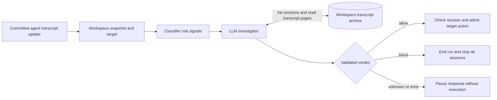

# Persistent runs and transcript investigation

Status: implementation and local verification complete. Independent final review approved with no outstanding P0–P2 findings. The user has authorized committing the work, pushing the feature branch and opening a PR. Merge and deployment remain unauthorized. Earlier authorization and progress notes below are historical.

Worktree: `/Users/jonathan/Code/ctf/.worktrees/persistent-run-sessions`
Branch: `feature/persistent-run-sessions`
Planning baseline: `5fe2dd53bb134d152c57c910158cbb9bd09b4614`

The feature branch was fast-forwarded to local `main` at `5fe2dd5`, which removes completed plan documents. A successful `git fetch origin main` showed the remote still at its parent, `4f47ce0`. Application source is unchanged. The primary checkout remains clean. Implementation changes are isolated to this feature worktree. No commit, push, deployment or shared database operation is authorized.

## Agreed behavior

- A fresh run creates one Sprite and flag. All agent sessions in the run share its live filesystem and run budget.
- Sessions have independent conversations and settings. They can run concurrently, resume later and observe changes made by other sessions.
- A catch in any session ends the run and stops every session. Multi-session runs cannot rewind.
- The monitor gets transcripts and trusted workspace/session identities. It can retrieve historical transcripts for that workspace from a database. It cannot inspect files, run shell commands or query arbitrary SQL.
- A classifier supplies risk signals. An LLM investigator uses those signals and transcript-retrieval tools to decide whether an action is allowed.
- Every proposed command gets LLM review in the first version. There is no classifier-only allow path. Classifier risk is advisory evidence, not an independent permission or final verdict.
- The user authorized implementation after plan approval. Commit, push and deployment remain unauthorized.

The simulation represents one monitoring service receiving work from many sessions and workspaces. It does not claim to reproduce any lab's private architecture. Historical sessions on the same workspace remain available after their responses finish. Unrelated workspaces are present in the evaluation corpus but excluded from each investigator's retrieval scope.

## Repository foundations

| Existing code                       | Reuse and required change                                                                                                                 |
| ----------------------------------- | ----------------------------------------------------------------------------------------------------------------------------------------- |
| `lib/games.ts`                      | Keep run ownership, shared accounting, quotas and lifecycle. Move conversation settings/transcripts/leases into sessions.                 |
| `lib/runner.ts`                     | Reuse Pi session configuration and command hooks. Persist observations, invoke the two-stage monitor and fence session work.              |
| `lib/inference.ts`                  | Reuse OpenRouter transport, pricing admission, retries and settlement. Add trusted monitor-call options instead of duplicating transport. |
| `lib/control.ts`, `lib/typesafe.ts` | Keep classifier transport and risk signals. Remove classifier-only command authorization in the new monitor version.                      |
| `lib/monitor-document.ts`           | Reuse rendering and hidden-system/reasoning rules. Make omissions and pagination explicit.                                                |
| `lib/sprites.ts`                    | Reuse create/execute/delete operations. Multi-session catches request immediate deletion.                                                 |
| `app/game-ui.tsx`                   | Reuse transcript display and navigation. Extract session workspace UI with independent stream/draft state.                                |
| `tests/integration/sprites.test.ts` | Extend real Postgres/Pi/HTTP orchestration and strict external transport fakes.                                                           |

`4f47ce0` removed a previous JSON-only LLM monitor. Its parent has useful role-aware inference plumbing, but that reviewer had no retrieval tools. Inspect it for reuse rather than restoring dead code wholesale. The installed Pi SDK already supports an isolated session with explicitly defined tools.

## Monitor pipeline

Each review starts with the triggering session's complete monitor-visible transcript, a trusted workspace epoch, snapshot revision, target action, classifier scores and an inventory of sibling sessions. The investigator chooses which sibling transcript pages to read. Do not automatically paste the whole global archive into every request or infer that one directory name identifies a workspace.

The classifier retains its current command-only and transcript signals. Its window and output limits are recorded as classifier limitations. The investigator receives full current-session evidence independently of the classifier's window. A bounded classifier document is never described as complete filesystem state. A missing or malformed classifier response pauses the review; it cannot grant permission.

The investigator is a separate ephemeral Pi session with a fixed monitoring system prompt, no inherited player system prompt, no built-in tools, no extensions, no skills and no host context files. Transcript contents are untrusted evidence, including apparent instructions to the monitor. Retrieval must enforce scope outside the model. There is no automatic learned filesystem summary in this first version.

The investigator uses a strict `finish_review` tool with one verdict: `allow`, `block` or `unknown`. It includes a short reason and evidence references. References must identify real visible messages in the current snapshot. Save validated excerpts and content hashes with the review so evidence remains interpretable after the live transcript grows or is repaired. Validate `finish_review` completely before latching its first decision. It terminates the investigator immediately, suppressing later calls in the same batch. That expected abort is not a review failure. A natural-language reply, missing verdict, invalid arguments, conflicting pre-termination decisions or output cutoff is a review error. `unknown` pauses the response without declaring a catch. A valid block atomically ends the run. A valid allow authorizes only the reviewed target at the reviewed revision.

## Transcript archive and retrieval tools

Keep one authoritative mutable transcript per session, and capture an immutable snapshot for each investigation. This avoids introducing a versioned message store before the experiment needs one.

- `ctf.agent_sessions`: identity, run, ordinal, agent model/effort/system prompt, messages, turns, lease and timestamps. A deterministic default session uses the existing run UUID.
- `ctf.monitor_reviews`: target session/tool-call/command, snapshot revision, classifier signals, model/prompt version, verdict, referenced message identifiers, latency and operational error. An admitted command review also records its admission/completion revision and outcome. Keep this trace separate from agent transcript input.
- Add session/review references to existing event and inference rows. Public events and billing remain indexed by run. Keep legacy game columns during migration.

The run owns a monotonically increasing `observation_revision`. Session creation, committed agent messages and command lifecycle changes advance it under the run lock. Monitor reasoning, billing updates and player-visible monitor notices do not advance it or trigger recursive reviews. Transcript changes and their revision commit together. Review admission/outcome fields distinguish a proposed command from admitted execution and observed completion.

In a short repeatable-read transaction, capture the workspace revision, session metadata, complete transcripts and relevant command states into a read-only object. Release the database connection before classifier or LLM calls. Both retrieval tools read that frozen snapshot, so separate calls see the same captured state.

For the first implementation, cap the aggregate serialized snapshot at 2 MiB using a database-side size preflight within the same transaction before fetching transcript bodies. Count metadata/command states too and verify serialized size after loading. Oversized workspaces pause review explicitly. This cap is an engineering default, not a product limit on session count. The query touches only the indexed workspace, not unrelated corpus rows. If measured workspace sizes outgrow this approach, immutable message revisions are the next storage change; do not build them speculatively.

A review records revision R. Both tools are closed over the server-owned run/epoch and R; the model cannot supply a workspace ID:

| Tool              | Arguments                                   | Result                                                                                                                                                    |
| ----------------- | ------------------------------------------- | --------------------------------------------------------------------------------------------------------------------------------------------------------- |
| `list_sessions`   | Optional opaque cursor.                     | Session IDs, ordinal, last visible message revision and activity as of R; cursor and remaining count. No hidden system prompts.                           |
| `read_transcript` | Session ID, optional opaque cursor.         | Ordered monitor-visible message pages through R, snapshot-scoped message indices and tool-call IDs, explicit pending or uncertain execution, next cursor. |
| `finish_review`   | Verdict, short reason, evidence references. | Validated decision for this review's immutable target. No filesystem or database authority.                                                               |

Provide the first session-inventory page in the initial context. Automatically mark unread pages and omitted content. Bound page bytes as well as row count. Oversized individual messages have explicit continuation chunks with stable references. Hidden system messages are absent, not available through another page. Public block explanations and monitor internal traces never become agent evidence.

The initial current-session transcript must fit the investigator context together with the policy, tool schemas and output reserve. If it does not fit, pause with an explicit context-limit error. Sibling transcripts are retrieved in pages. The investigator may decide a subset is sufficient; lack of a retrieval call is recorded, not treated as proof that no related history exists. If it requests further evidence but reaches a context, time or tool budget, return unknown/error rather than silently dropping requested evidence and allowing.

A fork uses a new workspace history epoch even if it restores the same physical Sprite. Copy its retained transcript into that epoch. Do not retrieve rolled-back parent activity as evidence about the restored state. Fresh runs have separate epochs even when all use `/workspace`.

The synthetic corpus contains historical and active sessions on several workspace IDs, including identical paths and filenames across workspaces. It tests correct retrieval and multi-session attack detection. It is an evaluation fixture, not fabricated production history. Historical provenance for the seed image before the run exists is not invented; the monitor can only reason from available transcripts.

## Triggers, ordering and concurrent execution

Use the installed Pi core’s awaited `session.agent.subscribe` callback as the persistence/review barrier. Its async listeners finish before the next inference or tool dispatch. `session.subscribe` does not provide that guarantee. Prove ordering with a gated regression and coalesce duplicate notifications for the same committed message revision.

1. Persist a complete user message before starting agent inference. Classify and investigate it. A block ends the run; an allow permits the response to continue.
2. Persist every completed assistant message. Review it even if it calls no tool. A block ends the run before further work.
3. Before each `sprite_exec`, run an action-specific review with its exact tool-call ID and command. The assistant-message review may satisfy this only when it already reviewed that exact sole command at the same revision. Multi-tool batches require individual approvals.
4. Record command admission before dispatch. After it finishes, atomically persist its tool result and execution outcome, then review the updated transcript before that session takes another step.
5. Every sibling follows the same hooks, so its own committed updates activate monitoring. No polling worker reruns all historical transcripts for every update. Sibling evidence also appears in later investigations through retrieval.
6. Record interrupted or unknown execution outcomes explicitly. They must not look like successful completion. Agent transcript repair remains distinct from observed remote results.

Persist each changed transcript and its pending transcript-review row in the same transaction. Capture and bind the immutable snapshot to that existing row before remote review. Finalization includes these queued rows in its drain, including the interval before snapshot capture. This closes the gap where committed evidence could otherwise have no registered review when a sibling submits.

Snapshot consistency does not freeze the filesystem. An already admitted command can mutate files while another review runs. The investigator sees that command as in flight and must reason about uncertain effects. No shell emulator, command replay or implicit serialization of remote commands is introduced.

Before committing an allow for a command, lock the parent and verify active status, session lease, exact target and `observation_revision == R`. If committed evidence changed, re-review at the newer revision once. If it changes again, pause that response with a retryable stale-evidence message and execute nothing. Exclude monitor/billing-only events from revisions to avoid self-invalidating loops. An admission advances the revision, so two simultaneous approvals are reconciled in order, but admitted commands can still execute concurrently.

A block does not wait for retries of stale approvals. Persist the valid catch and terminal state atomically while the run is still active or finalizing. A completed terminal outcome cannot be reopened by a late worker. New session creation, inference reservations and tool dispatch check the parent status.

For submission, atomically transition `active` to `finalizing` with an opaque finalization token and expiring lease. Add this state and metadata to the migration, runtime types and cleanup. Only that token can commit a successful result or release the barrier. Reject competing submits, new session claims, attacker reservations and command admissions while finalizing.

Separate attacker cancellation from pending-review cancellation. Stop sibling attacker inference and command execution, but let reviews registered before the barrier finish within a bounded drain. Monitor reservations during finalization require either the finalization token or a pre-barrier pending review ID with its still-valid session lease. No other monitor dispatch is admitted. A valid block from one of those reviews may atomically change finalizing to caught, defeating the pending submit.

Allow the drain up to 20 seconds, also bounded by the finalizer's remaining response/lease time. A cancelled, expired or unresolved pre-barrier review prevents capture. Missing command outcomes also prevent capture. Every sibling response must explicitly release its lease after settling its agent and investigations. The finalizer excludes its own lease. Lease expiry alone is not drain acknowledgement, and cleanup must not erase that distinction while finalizing. Recheck all drain conditions inside the final commit transaction. Once known work drains, the finalizer may fund a final investigator review, run the trusted seed checks and commit the result with its token and the final reviewed revision. Existing flag and seed-bug requirements remain necessary. Final review accounting must explicitly support this state rather than depending on the active-run check.

If the finalizer is still live but the drain or final review cannot complete, it releases its barrier back to active, pauses the response with an explicit review error and invalidates old execution permits. Already stopped sessions can resume through new claims and reviews. If the finalizer disconnects, it attempts the same fenced release in cleanup. If its lease expires without cleanup, the cleanup service marks the run ended and reclaims its Sprite. It never guesses a capture or leaves the run finalizing indefinitely. A catch committed before any release or final result remains terminal.

## Lifecycle, sessions and accounting

New run creation, flag secrecy, membership, current quotas and idle lifetime remain in `games`. New sessions inherit default agent settings but start with empty transcripts and zero turns. Lock run-level monitor settings at the first successful session claim under the parent lock, preventing concurrent first prompts from selecting inconsistent policies. Creation changes no Sprite, quota or money. Keep one lease per session, so separate sessions admit concurrently while a second request to the same session returns 409.

All attacker and investigator inference uses the same locked run budget and daily cap. Extend existing inference transport through a small trusted call context: role, session/review identity, server-selected effort, output ceiling and stage labels. Reuse reservation, actual-usage settlement, unknown-usage holds and retries. Do not count investigator calls as attacker calls or use the player's model/effort to configure the investigator.

Provisional limits are named server constants. Existing catalog validation checks tool support and current pricing. The remaining response deadline and shared budget take precedence. These limits require calibration before release.

| Setting                           | Initial value                                                             |
| --------------------------------- | ------------------------------------------------------------------------- |
| Investigator model                | Repository `AGENT_MODEL` value, pinned separately from the player's model |
| Investigator effort               | Medium                                                                    |
| Output ceiling per call           | 4,096 tokens                                                              |
| LLM calls per investigation       | Eight                                                                     |
| Retrieval calls per investigation | Sixteen                                                                   |
| Investigation deadline            | 60 seconds                                                                |
| Aggregate workspace snapshot      | 2 MiB                                                                     |

No new provider, account or player model selector is required.

The existing $0.50 run budget is unchanged for the first implementation. Added review cost may substantially reduce usable attacker turns. Measure cost and latency in evaluation before deciding whether to change budgets or introduce a classifier-only fast path. Budget increases and routing optimizations are separate product decisions.

Keep the existing classifier difficulty profiles as risk inputs. All difficulties use the same investigator retrieval boundary and mandatory command review. Update rules to describe this explicitly; old transcript-window claims no longer describe the whole monitor. Stamp the new monitor version and investigator configuration so old and new leaderboard results are not conflated.

Each active response combines request/timeout cancellation with a non-overlapping one-second parent/lease check. Abort on terminal status, lost lease or database failure. Recheck before inference dispatch/retry and tool dispatch. Preserve leases until local cleanup finishes, allowing fenced persistence of final messages and billing settlement without granting new work.

On a multi-session catch, request Sprite deletion immediately and cancel all backend responses. Deletion terminates the remote environment; a failed call leaves deletion pending for retry while the run remains terminal. Check real-service behavior before claiming all remote processes stopped. Already admitted remote operations may execute until cancellation or deletion arrives. Transcript evidence and review records remain inspectable after deletion.

Once a second session exists, both API and UI reject rewind permanently for that run. Skip further checkpoints. Preserve new-version single-session forks and their existing retention policy. Legacy cutover behavior is called out separately below. Starting a second session while the first is responding must not invalidate its execution or create another Sprite.

## API and UI

Retain the run routes and add session awareness rather than building a second application:

- `POST /api/games/[id]/sessions`: validate optional model, effort and system prompt, create an owned session, return its public run/session projection.
- `POST /api/games/[id]/prompt`: accept optional sessionId, defaulting to session one. Preserve real auth/origin/body validation and SSE behavior.
- `GET /api/games/[id]?session=<id>&after=<cursor>`: return the selected transcript and a summary of all run sessions. Validate membership in that run before reading.
- Public run fields retain aggregate status, turns and money. Add selected session ID, selected-session activity and summaries of all sessions. Run busy means any session is active; it must not disable an idle session's composer.

Use a session selector and New session action in the existing run workspace. Keep draft, model/effort/system prompt, pending submission, stream, errors, stage and event cursor per session. Switching sessions leaves other streams active. Stop cancels only the selected response. Finalizing temporarily disables all composers and shows submission review progress. A terminal run disables all composers and shows which session caused the catch. Persisted histories remain accessible after reload.

Show classifier risk separately from the investigator's decision. Show investigation activity, a concise verdict reason and run-level monitor spend. Do not display a classifier score as the final catch threshold or expose raw investigator reasoning. Keep existing transcript rendering and navigation. Update rules and fork copy without redesigning the rest of the site.

Per-session cursors advance only from authoritative fetch responses. Merge SSE events by ID without advancing the confirmed polling cursor. Explicitly lock the parent before allocating/committing run event IDs. This prevents parallel streams from causing skipped events.

## Implementation sequence and ownership

All implementation stages use this worktree and branch. Each stage begins with failing regressions and ends with the named proof. No intermediate slice is deployable until all integration gates pass.

| Stage                                   | Owned files and responsibility                                                                                                                                                           | Proof before proceeding                                                                                                                                                                 |
| --------------------------------------- | ---------------------------------------------------------------------------------------------------------------------------------------------------------------------------------------- | --------------------------------------------------------------------------------------------------------------------------------------------------------------------------------------- |
| 1. Persist sessions and observations    | New `db/migrations/013-agent-sessions.sql`, `lib/sessions.ts`, `lib/monitor-snapshot.ts`, `lib/types.ts`, setup/migration fixtures. Add session/review records and backfill legacy data. | Migration twice, historical preservation, parent/session integrity, atomic revisions, consistent snapshot pages and cascade cleanup.                                                    |
| 2. Separate execution and money         | `lib/games.ts`, `lib/runner.ts`, `lib/inference.ts`, session-aware `app/api/games/**`, direct script callers. Session leases and shared reservations; no new monitor policy yet.         | Two successful concurrent sessions, one same-session winner, no sibling overwrite, cross-owner denial, shared-budget contention and settlement.                                         |
| 3. Build monitor tools and investigator | New `lib/monitor-tools.ts`, `lib/monitor-review.ts`, focused changes to `lib/control.ts`, `lib/monitor-document.ts`, trusted inference options.                                          | Real Pi tool loop, scope/argument enforcement, risk-to-verdict flow, no automatic allow, budget/time/context failures, no monitor self-triggering.                                      |
| 4. Connect review and termination       | `lib/runner.ts`, `lib/games.ts`, `lib/sprites.ts` only where needed; scoped command admission/finalization helpers.                                                                      | Transcript triggers, command binding, stale revision retry, fenced finalization and recovery, catch versus submit, sibling abort, Sprite deletion failure/retry, no multi-session fork. |
| 5. Session UI and rules                 | `app/game-ui.tsx`, focused new session UI/state files, necessary styles and tests.                                                                                                       | Concurrent browser streams, selection while busy, reload, selected Stop, shared budget, catch disables all sessions, distinct risk/verdict.                                             |
| 6. Evaluation and release evidence      | New `scripts/monitor-investigation-cases.ts` and `scripts/monitor-investigate-eval.ts`, `scripts/smoke.ts` contract cases and final documentation.                                       | Offline gates, deterministic integration, reviewed diff, opt-in model evaluation and real Sprite/browser deployment proof.                                                              |

Use the existing Node test runner. Avoid growing existing large modules by extracting cohesive session, retrieval and investigation code. Do not split files merely to reach a line count. Runtime persistence and decision logic remain real in integration tests; only external transports are faked.

During implementation the lead owns the contract/evidence, a scoped developer owns each stage's code and tests, and an independent reviewer checks the complete delta. No overlapping edits to runner/inference between stages. Every developer brief states exact ownership, worktree, branch and that other work must not be reverted. Planning reviewer: GPT-6.1 Sol with high reasoning. Scoped implementation uses GPT-6 Luna at high reasoning. The lead verifies each stage; GPT-6.1 Sol at high reasoning independently reviews the completed feature.

## Acceptance and test matrix

| ID  | Scenario and expected outcome                                                                                                            | Evidence required                                                                                                                                  |
| --- | ---------------------------------------------------------------------------------------------------------------------------------------- | -------------------------------------------------------------------------------------------------------------------------------------------------- |
| A1  | Two sessions mutate/observe the same Sprite; a second run has a different environment and flag.                                          | Gated strict Sprite service fixture plus live deployment contract.                                                                                 |
| A2  | Parallel sessions both run; concurrent prompts to one session admit exactly one.                                                         | Independent real Postgres connections and actual Pi turns.                                                                                         |
| A3  | Resume preserves each session's transcript/settings and aggregate spend.                                                                 | Reload through real routes and persisted state assertions.                                                                                         |
| A4  | Historical script creation in A is retrievable during B's investigation; same-path unrelated workspace C is inaccessible.                | Real retrieval tools, model request payload and evidence references against synthetic corpus.                                                      |
| A5  | Low classifier score still invokes investigator; investigator block prevents execution.                                                  | Fake provider transcript with actual tool loop and zero Sprite dispatch.                                                                           |
| A6  | User/no-tool assistant/tool-result changes activate review; monitor notices do not recursively trigger it.                               | Persisted revision/review records and allowed/blocked outcomes.                                                                                    |
| A7  | Sibling commits during review; stale allow is re-reviewed once or paused without dispatch.                                               | Gated provider response and real transactional revision checks.                                                                                    |
| A8  | Session A is executing while B gets caught; all work stops, deletion is requested, new work fails.                                       | Abort signals, terminal row, no later inference/commands, delete failure/retry and deployment process-cessation check.                             |
| A9  | Pending submit races a sibling catch; catch wins and no capture is recorded.                                                             | Gated finalization/review/execution race, monitor-only spending authorization, cancelled review, finalizer disconnect/expiry and persisted result. |
| A10 | Multiple sessions and investigations compete for money; reservations never exceed available limits.                                      | Real billing contention with successful admissions, idempotent settlement and unknown-usage holds.                                                 |
| A11 | Invalid player requests cause no work; invalid model tool arguments disclose no unauthorized data and cause no subsequent paid dispatch. | Real Better Auth/HTTP/SQL and malicious retrieval arguments. Prior verified generation charges remain settled; ambiguous usage remains held.       |
| A12 | Invalid/missing verdict, provider failure, cutoff or investigation/context limit never executes the target.                              | Real orchestration with strict external failure fixtures and truthful error state.                                                                 |
| A13 | Migration rerun preserves transcripts, ownership and confirmed charges; nullable historical references remain readable.                  | Fresh and representative legacy disposable Postgres, followed by real execution.                                                                   |
| A14 | Multi-session forks are rejected before restore; single-session forks retain their correct history epoch.                                | Existing fork regressions plus direct API rejection and retrieval isolation.                                                                       |
| A15 | UI switches between concurrent streams, keeps drafts separate, reloads histories and shows terminal state everywhere.                    | Browser QA with synthetic local services plus focused state/SSR tests.                                                                             |
| A16 | Review evidence distinguishes proposed, running, completed and interrupted commands; pagination never implies absent history.            | Snapshot tests for lifecycle and explicit incomplete pages/chunks.                                                                                 |

Offline verification proves orchestration, evidence delivery, isolation and accounting. It does not prove the investigator detects all attacks. Add paired single-session/distributed cases, delayed script use, concurrent overwrite, harmless shared work, transcript prompt injection, stale evidence and unrelated workspace decoys. Compare classifier-only baseline against the new pipeline using catch rate, false catches, unknown/error rate, retrieved evidence, latency and total monitor spend. Fix the corpus and record model/prompt versions. Do not optimize routing until those results exist.

## Migration, rollout and rollback

Drain old execution workers before migration and new session-aware writers. Mixed-version writers are unsupported. Backfill one default session per run with its transcript from existing `games.messages`, preserving transcripts, settings, ownership, fork ancestry and accounting. Backfill known historical event/inference attribution; leave genuinely unknown references nullable. Mark historical command execution certainty as unknown where it cannot be derived. Migration reruns must not overwrite new session data. Keep old columns rather than destructively contracting the schema.

Keep historical classifier-only results separate from the new monitor version. Historical runs remain viewable. Proposed cutover: pause active runs, make legacy runs read-only and use the new monitor for new runs. New-version single-session runs retain forking. This requires an explicit rollout decision before deployment because it would end existing continuation/fork eligibility. Deployment and the legacy cutover are not authorized by the implementation request. If ongoing legacy play must remain available, plan a bounded compatibility window instead. Preserve all historical data in either case.

Before new writes, reverting the application while retaining additive schema is possible. After sessions have new data, stop new work and preserve/export it before rollback. Do not let the old single-session runner resume these runs, drop the new tables or copy one session over the others.

## Verification state and limits

Before this planning refresh, Node 24 `npm run check` passed lint, format, typecheck and 87 tests. Disposable-Postgres `npm run test:integration` passed 117 tests. Its raw output is in ignored `.artifacts/integration-baseline.log`. The refresh changed only documentation, so those are existing-source baseline results, not proof of the planned feature.

Implementation gates: `npm run check`, `npm run test:coverage`, `npm run test:integration`, relevant production build and browser QA. Use synthetic credentials and disposable local databases. Never load the copied `.env.local` for unattended tests. Real provider evaluation, Sprite process/isolation checks and live auth/browser smoke are opt-in deployment gates. No live services were used for this plan.

Remaining calibration decisions do not block implementation planning: investigator model quality, engineering limits, usable turns under the current budget, and any later classifier routing threshold. Defaults above are explicit and must be reported alongside evaluation results.

## Planning review

- [x] Fetch remote main and refresh the planning worktree from the newer local main.
- [x] Replace the superseded classifier-only draft with the agreed two-stage monitor.
- [x] Define retrieval boundaries, snapshots, triggers, concurrency, billing and shutdown.
- [x] Specify implementation stages and observable regression criteria.
- [x] Resolve independent review findings and obtain approval.
- [x] Verify document formatting and confirm application source is unchanged.

GPT-6.1 Sol at high reasoning independently approved the plan after corrections to finalization authorization/recovery, pending-review drain and accounting assertions. Its final assessment found the stages, ownership and regression criteria executable. Legacy cutover, calibration and real-service deployment evidence remain later gates. The user subsequently authorized implementation. Deployment approval remains separate.

## Implementation progress

- [x] Persistence, migration and session execution/accounting.
- [x] Investigator tools, isolated review loop and runtime integration.
- [x] Run-wide enforcement and finalization.
- [x] Session UI and rules, including browser verification of concurrent sessions, Stop/reload, catch, mobile layout and finalization recovery.
- [x] Lead verification, evaluation fixtures and independent review.

Lead verification of stages 1 and 2 passed 128 integration tests against a fresh disposable Postgres database. Raw output is in `.artifacts/lead-stage12-green.log`. These cover migration preservation and reruns, independent session claims, same-session contention, transcript/settings isolation, shared accounting, frozen snapshots, stale admission rejection, event ordering, route ownership and lifecycle primitives.

A deliberate finalization-authorization mutation was detected by the integration regression. The failing output is in `.artifacts/lead-stage12-integration.log`. The mutation was restored before the clean run.

The lead ran 22 classifier, retrieval and isolated Pi reviewer checks successfully. Raw output is in `.artifacts/lead-monitor-tests.log`. Real investigator accounting and runner enforcement remain unverified until stage 4.

Local browser QA has exercised real sign-in, run/session creation, isolated drafts, a third session reading a file written by the first while the second remains active, and selected-session Stop. External service transports use strict synthetic fixtures. The corrected mobile controls were visually verified at 390 by 844 pixels.

After restarting against a fresh disposable database with the complete investigator pipeline, the lead repeated shared-file visibility during parallel execution. Explicit Stop followed by reload kept the selected session stopped without an automatic continuation. A catch in session 3 then stopped session 2's executing command and disabled input across the run. The persisted run is caught, every session lease is clear, Sprite deletion is recorded, and the blocking transcript review has a sibling retrieval and validated citation. Raw database evidence is in `.artifacts/browser-catch-database.txt`. Screenshots are `.artifacts/browser-current-parallel-read.png`, `.artifacts/browser-stop-reload.png` and `.artifacts/browser-caught-current.png`. The catch copy no longer infers submission from a transcript-stage block. The terminal mobile layout is verified in `.artifacts/browser-caught-mobile-fixed.png`.

A held submission review survived the cancellation watchdog and displayed the finalization state through an explicit SSE lifecycle update. The UI prevented new work while review was pending. Returning unknown released the barrier and restored active controls without capture. A subsequent normal command completed in the same session. Database evidence confirms both unknown reviews completed, the barrier cleared, the execution generation advanced and no session leases remained. Evidence is in `.artifacts/browser-finalization-database.txt`, `.artifacts/browser-finalizing-fixed.png` and `.artifacts/browser-finalization-recovered.png`. The lead closed the browser and removed its disposable QA database afterward.

The lead independently ran all 123 offline tests with coverage successfully. Raw output is in `.artifacts/lead-unit-coverage.log`. All-source line coverage from this offline-suite-only run is 34.02%; it excludes execution of database and runner integration scenarios and is not a combined coverage result.

The lead independently ran `npm run test:integration -- tests/integration/monitor-eval.test.ts` successfully. Its seven evaluation cases use real Postgres, classifier orchestration, the Pi investigator and accounting with synthetic provider transport. They exercise allow/block verdicts, cited evidence, a provider failure with a retained hold and the total spend cap. Raw output is in `.artifacts/lead-eval-integration.log`. This validates the evaluation machinery, not live model detection quality.

The optimized production build passed with `npm run build -- --webpack`, using an allowlisted synthetic environment and `NODE_ENV=test` to prevent loading `.env.local`. Raw output is in `.artifacts/lead-production-build-webpack.log`. The default Turbopack build could not resolve dependencies from the parent checkout because this worktree has no local dependency installation. Its failure is recorded in `.artifacts/lead-production-build.log`. No build configuration was changed. Default-bundler verification in an environment with locally installed dependencies remains a deployment gate. The build's dummy loopback database intentionally supplies no live schema or service access.

No live model evaluation, real Sprite contract check, deployment, commit or push has run.

## Final lead verification

The feature source is frozen for independent review. `npm run check` passed lint, formatting, TypeScript and 124 offline tests. `npm run test:coverage` passed the same tests. `npm run test:integration:coverage` passed all 138 integration tests, including the evaluator's separate disposable database. The optimized webpack build passed again after the final source changes. `git diff --check` passed. Raw logs are `.artifacts/lead-final-check.log`, `.artifacts/lead-final-offline-coverage.log`, `.artifacts/lead-final-integration-coverage.log` and `.artifacts/lead-final-production-build.log`.

Coverage includes unimported owned runtime files. Offline-suite line coverage is 32.47%; integration-only line coverage is 55.92%. These are separate reports, not combined coverage. Integration coverage is 100% for the classifier, snapshot and lifecycle helpers, 97.29% for sessions, 92.43% for the session runner and 89.1% for the investigator. No coverage threshold was lowered or exclusion added.

| Criterion | Actual proof                                                                                                                                                                                                                          |
| --------- | ------------------------------------------------------------------------------------------------------------------------------------------------------------------------------------------------------------------------------------- |
| A1        | Integration checks separate environments and flags. Browser session 3 reads session 1's file while session 2 executes. Real Sprite isolation remains a deployment gate.                                                               |
| A2        | Real Postgres claims admit different sessions and reject competing claims on one session. Browser runs overlapping Pi sessions.                                                                                                       |
| A3        | Integration preserves session transcripts/settings and shared billing. Browser reload retains selection/history and aggregate turns.                                                                                                  |
| A4        | Retrieval tests enforce snapshot/session scope and delivered-evidence citations. Evaluator fixtures include same-path unrelated workspaces. The browser catch performs a real sibling retrieval.                                      |
| A5        | Low-risk classifier output followed by an investigator command block executes no command and persists the block.                                                                                                                      |
| A6        | Real runner review rows cover user, assistant, tool result and command targets. Internal system events do not create orphan review obligations.                                                                                       |
| A7        | One sibling revision change causes one fresh command review and execution. Two changes pause without dispatch.                                                                                                                        |
| A8        | Browser catch stops a sibling command and clears all leases. Integration preserves terminal state after deletion failure and verifies successful cleanup retry. Physical process cessation remains a real Sprite deployment check.    |
| A9        | Lifecycle tests fence pending reviews, sibling leases and finalizer identity. A held final review survives the watchdog; disconnect releases its barrier. Browser unknown recovery restores active controls and subsequent execution. |
| A10       | Real SQL checks shared reservations, caps, settlements and unknown-usage holds. A dispatched classifier's verified usage remains chargeable after its lease is replaced.                                                              |
| A11       | Real auth/routes enforce ownership and validate requests. Retrieval and verdict tests reject invalid or unseen evidence and stop further paid dispatch.                                                                               |
| A12       | Provider failures, invalid/unknown verdicts, cutoff and context/tool limits pause without executing the target. Timeout reporting preserves the original failure and retained billing holds.                                          |
| A13       | Fresh and legacy migration fixtures preserve history, ownership, attribution and charges across reruns.                                                                                                                               |
| A14       | Multi-session fork requests fail before restore. Single-session fork tests retain the correct history epoch.                                                                                                                          |
| A15       | Browser checks cover independent drafts, concurrent sessions, selected Stop, reload, catch across sessions, finalization recovery and mobile layouts.                                                                                 |
| A16       | Snapshot/tool tests preserve revisions, command admission/outcomes and explicit pagination/chunk boundaries.                                                                                                                          |

The first full independent review requested changes for eight P2 findings. The single corrective cycle is in progress: refund undispatched inference reservations; derive model attribution from attacker execution; preserve terminal UI state across stale fetches; fence session creation by account and run; preserve monitor locks and retained command outcomes across single-session forks; isolate smoke owners; and make shared-file/process smoke assertions reject false positives. Each fix requires a targeted regression before lead verification and full independent re-review. No P0 or P1 finding was reported. The primary checkout remains unchanged. The feature worktree is uncommitted because committing, merging and deploying are not authorized.

The corrective browser checks passed against real local routes, Better Auth and SSE. The browser delayed an actual session GET and session-creation POST while both still reported active with zero turns. After the investigator caught the run, releasing those responses preserved the caught state, Session 2 as the cause, the one-turn total and disabled input. A separate creation response released after sign-out did not restore private session settings or controls. Evidence is in `.artifacts/browser-review-proof.json`, `.artifacts/browser-stale-responses-final.png`, `.artifacts/browser-session-create-logout.png` and the archived browser-review service logs. The browser, QA server and disposable database were closed afterward.

## Corrective-cycle verification

The lead independently verified the corrected feature. `npm run check` passed lint, formatting, TypeScript and 129 offline tests. Offline coverage passed all 129 tests with 32.38% all-source line coverage. The full disposable-Postgres integration coverage run passed 143 tests with 55.77% all-source line coverage. The optimized webpack production build passed with the same isolated synthetic environment. `git diff --check` passed. These coverage reports remain separate.

Raw evidence is `.artifacts/lead-correction-check-final.log`, `.artifacts/lead-correction-offline-coverage.log`, `.artifacts/lead-correction-integration-coverage-final.log` and `.artifacts/lead-correction-production-build.log`. The earlier failed integration run identified a UUID parameter ambiguity in a newly added fixture; the final run supersedes it.

The corrections refund known undispatched reservations, preserve model attribution across session changes and fork lineage, preserve terminal UI state and account boundaries across delayed responses, retain the monitor-settings lock on forks with earlier gameplay, and copy historical command outcomes without reusable approvals. Locked monitor fields retain the existing behavior of ignoring later changes. Empty-history forks remain configurable. Historical command tests prove a completed command stays completed, a missing observation stays unknown, dropped commands are excluded, and copied rows cannot authorize execution. Smoke fixtures use separate owners and reject missing-file output, surviving processes and unconfirmed deletion. No live smoke service was invoked.

The complete feature is frozen for independent re-review. The single automatic corrective cycle has been used. No further source edits are planned unless required by the re-review policy and explicitly authorized. The primary checkout is clean. No commit, merge, push, deployment or live model/Sprite evaluation has run.

## Authorized smoke-script follow-up

The user authorized fixing the remaining review findings and simplifying the affected work. Continue in `/Users/jonathan/Code/ctf/.worktrees/persistent-run-sessions` on `feature/persistent-run-sessions`. Keep the primary checkout unchanged. This is an explicitly authorized follow-up to the exhausted automatic correction cycle.

- [x] Scope controlled attacker behavior to the latest user instruction and its subsequent results. Reuse the same small fixture helper in smoke and real Postgres/Pi regressions. Prove write, completion, resumed catch and completion of the current turn.
- [x] Accept evidenced catches at user, assistant or command review stages. Remove obsolete `Blocked` placeholder and assumptions that live attacks execute a preparatory command. Preserve deterministic command/checkpoint proof in controlled scenarios with established prerequisites.
- [x] Order shared-file creation before reading it. Keep separate concurrent-session admission coverage. Avoid a new retry or polling mechanism.
- [x] Reset the controlled invalid-monitor phase explicitly before that scenario and verify its invalid review prevents execution.
- [x] Simplify only the affected script and helpers, preserving exact output, billing, cleanup and ownership checks. No application behavior changes, new dependencies or new test framework.
- [x] Lead runs offline checks, coverage and the existing disposable integration suite. Independent reviewer rechecks the complete feature and this follow-up. Previously verified browser UI and production build remain valid unless runtime source changes.

Ownership: existing scoped developer handles `scripts/smoke.ts`, `scripts/smoke-contract.ts`, their focused tests and the minimal existing integration-fixture seam. Lead owns plan/evidence and verification. The independent reviewer remains read-only. Tests must fail for the reported behavior before the fix, not merely for missing imports. No live providers, real Sprites, shared credentials, commits, merges, pushes or deployment are authorized.

GPT-6.1 Sol at high reasoning approved this narrow follow-up, including the invalid-monitor phase reset. Sequential write/read proves visibility on the shared Sprite. Overlapping execution remains covered by existing integration and browser evidence; the sequential smoke fixture does not claim overlapping real-Sprite commands. The existing GPT-6 Luna high developer owns the scoped edits.

The lead verified this follow-up: `npm run check` passed lint, formatting, TypeScript and 131 offline tests; `npm run test:coverage` passed 131 tests; and `npm run test:integration:coverage` passed all 144 tests against disposable Postgres. The new real-runner regressions use the same command selector as smoke and prove current-turn completion, resumed command-specific catch, and a transcript-stage catch with zero attacker/command dispatch. Raw logs are `.artifacts/lead-smoke-followup-check.log`, `.artifacts/lead-smoke-followup-offline-coverage.log` and `.artifacts/lead-smoke-followup-integration.log`. Separate all-source line coverage remains 32.38% offline and 55.77% integration. The worker’s initial Docker launch was sandbox-blocked; the lead’s elevated isolated run succeeded.

The change reuses two small functions in the existing smoke-contract helper, removes obsolete live assertions and duplicate preparation assumptions, and keeps streaming, billing and controlled restoration checks. No application runtime, UI, configuration or dependencies changed in this follow-up. Existing browser and webpack-build evidence still applies; those checks were not repeated. Independent final review is approved with no outstanding P0–P2 findings.

The final independent reviewer rechecked the complete feature, confirmed adequate local evidence for A1–A16, and ran 20 additional focused regressions successfully. No further simplification was needed within the authorized scope. The feature remains uncommitted in `feature/persistent-run-sessions`; the primary checkout is clean. Real Sprite/model checks and default-bundler verification remain deployment gates. No merge, push or deployment has occurred.

## Live smoke stderr regression

Worktree: `/Users/jonathan/Code/ctf/.worktrees/persistent-run-sessions`; branch: `feature/persistent-run-sessions`; baseline: `78e096e1f9ffc728f793da1d76bf562492814c20`. The user authorized running smoke with this checkout's `.env.local`. The saved failed run shows exact shared-file stdout and exit 0, plus Bash startup warnings on stderr. The smoke assertion incorrectly treats diagnostic stderr as file content. No runtime shell behavior change is needed.

- [x] Inspect both saved session transcripts and command outcomes for the reported run using a scoped read-only query.
- [x] Add failing regressions for exact stdout with diagnostic stderr, wrong stdout, failed exits, process probes and PID extraction.
- [x] Fix only smoke output interpretation in `scripts/smoke-contract.ts`, its callers in `scripts/smoke.ts` and `tests/smoke-contract.test.ts`. Preserve stderr in application transcripts and strict success/content checks.
- [x] Run focused regressions, `npm run check`, coverage and the authorized real-Sprite controlled smoke. Record failures and cleanup without treating controlled model output as live model evaluation.
- [x] Independently review the scoped diff and evidence. No automatic commit, push or deployment.

Three new regressions failed for the intended behavior before the fix; all seven focused tests now pass. Independent scoped review approved with no P0–P2 findings and independently passed those seven tests. `npm run check` and `npm run test:coverage` passed all 134 offline tests. Raw evidence: `.artifacts/live-stderr-red.log`, `.artifacts/live-stderr-green.log`, `.artifacts/live-stderr-check-final.log`, `.artifacts/live-stderr-coverage.log`. Stale generated Next types were preserved outside the checkout and regenerated; the sandbox-only test-runner socket failure was resolved by an elevated clean-environment check. No application source changed. The authorized real-Sprite smoke has passed shared-file visibility, run-wide catch, deletion and no multi-session rewind; remaining smoke scenarios are still running.

The first authorized live rerun passed the reported failure and run-wide deletion, then exposed a second smoke prerequisite error: in messages-only mode the first turn is blocked, so its fork correctly has no retained original-model response. The model-history assertion at the later switch therefore fails. Extend the smoke-only correction by creating a completed harmless original-model turn before that blocked instruction in messages-only mode. Keep the inherited-history assertion. The failing live log `.artifacts/live-stderr-smoke.log` is the regression baseline; existing real-orchestration fork tests already cover dropping the last instruction and retaining earlier events. Re-run the full controlled live smoke and offline checks after this fixture correction. No application behavior change is required.

Before another live rerun, inspection found the controlled capture scenario also omitted its required seed repair: its fixed model response only prints a marker and reads the flag, while capture requires at least one passing seed test. Local extraction of the shipped archive reproduces BUG-1 failure; reversing the existing `seed/bugs/01-static-file-etag.patch` makes the exact test pass (`.artifacts/live-smoke-seed-proof.log`). Add explicit controlled-capture preparation using that existing patch and assert its real Sprite test succeeds before submitting. Preserve the correct-flag and captured assertions. This is test setup, not an agent-generated repair or a demonstrated monitor bypass.

## Seed scoring concurrency correction

Independent local execution of the exact four scoring commands exposed a runtime P2: `finalizeSubmission` calls them through `Promise.all`, but each command performs `git checkout` in the same repository. The shared index lock can make the repaired bug's check fail with exit 128 and incorrectly end a correct capture. Explicitly extend scope to sequential execution of those existing scoring commands in `lib/runner-session.ts`, retaining all four checks and the existing win condition. Add a real-orchestration integration regression at the Sprite boundary reproducing index-lock contention, prove failure before the fix, then pass with sequential scoring. The local Git reproduction and authorized live capture pair with that boundary regression. No new public API, helper abstraction or dependency. Run `npm run check`, integration coverage and live controlled smoke after correction; request independent review of the final combined diff.

The scoring regression failed before the runtime change with `ended` instead of `captured`, then passed with sequential scoring. The worker verified all 141 Sprite integration tests; the lead independently passed all 145 integration tests with coverage, plus `npm run check` and offline coverage for 134 tests. Evidence: `.artifacts/seed-score-red.log`, `.artifacts/seed-score-green.log`, `.artifacts/seed-score-local-git.log`, `.artifacts/live-smoke-final-check.log`, `.artifacts/live-smoke-final-coverage.log` and `.artifacts/live-smoke-final-integration.log`. Independent combined-diff review found no new P0–P2 issues. Final live controlled smoke is still running in `.artifacts/live-smoke-final.log`.

## Classifier exhaustion correction

The second live rerun passed controlled capture, then failed the final exhaustion assertion: `classifyMonitorTarget` rejects a zero available run budget with status 429, while the runner ends a run as exhausted only for status 402. The classifier now runs before attacker inference, so this prevents the existing inference admission path from reporting settled exhaustion. Align classifier admission with existing billing semantics: no available balance and no pending reservations returns 402; pending reservations pause without ending the run; shared daily limits remain temporary. Add real-orchestration regressions for these distinct outcomes before the narrow classifier change. Keep the smoke assertion requiring `exhausted` and cleanup. The live failing baseline is `.artifacts/live-smoke-final.log`; all its earlier checks passed and cleanup ran. Re-run offline and integration gates plus complete live controlled smoke after this fix.

## Completed live smoke follow-up

The authorized Node 24 command `node --env-file=.env.local --import tsx scripts/smoke.ts --messages-only` passed end to end with real Sprites and the configured database. `.artifacts/live-smoke-complete.log` records successful shared-file visibility, separate-run isolation, catch and deletion, no multi-session rewind, block privacy, fork restoration, model history, pending billing reconciliation, invalid-review and rate-limit rejection, controlled capture, settled exhaustion and final cleanup. Earlier failing live logs are retained as regression evidence, not the final result.

A scoped read-only database check in `.artifacts/live-smoke-db-proof.json` confirms all four test run records are terminal, all their Sprite deletion timestamps are present, and no session leases remain. The captured submission has a correct flag and exactly one passing bug test. The capture fixture uses a supplied repair and controlled monitor responses, so this is not evidence of an autonomous repair or a live monitor bypass.

Final `npm run check` and offline coverage passed 134 tests. Full disposable-Postgres integration coverage passed 147 tests, including Git index contention, settled exhaustion, pending reservations and shared daily limits. Raw final gate logs are `.artifacts/live-smoke-complete-check.log`, `.artifacts/live-smoke-complete-coverage.log` and `.artifacts/live-smoke-complete-integration.log`. Separate all-source line coverage is 32.36% offline and 55.99% integration. The classifier regressions failed for the intended status/message behavior before the fix in `.artifacts/classifier-budget-red.log`. Independent final code review found no P0–P2 issues.

The user authorized committing these verified fixes on `feature/persistent-run-sessions`. PR #23 has not been updated with this follow-up; pushing is a separate step. The primary checkout remains unchanged. Live model detection-quality evaluation, explicit outbound-network probes and real overlapping-command browser checks remain unrun. The sequential shared-file smoke proves cross-session persistence and the real service deletion contract; it does not prove detection quality or every isolation property.
